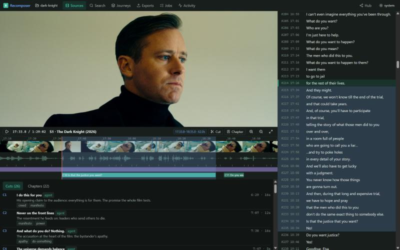

# Recomposer

An agent-operated studio for turning films, podcasts and talks into **journeys**: authored sequences of
meaningful cuts, with captions, overlays and music, exported in any format and language and shared on a
hub as **recipes** (sources and timecodes, never the media).

You work *with* an agent. Claude Code (or any MCP or CLI-capable agent) runs in a project folder: it reads
transcripts, writes chapters, makes cuts and composes journeys through the `recomp` verbs. You watch, select
and correct in the local viewer. Every change is logged and undoable, and the agent can never overwrite your work.



```
recomp project init dark-knight --kind movies
recomp source add "D:\Recomp\Video\The.Dark.Knight*.mp4"     # files stay where they are; subtitles imported
recomp transcript outline S1 && recomp transcript read S1 --from 0 --to 15:00
recomp chapter set S1 --input chapters.json
recomp cut add S1 --quote-start "And what do you do" --quote-end "Nothing." --why "…"
recomp journey new "Do something" --cuts C3,C5,C15,C7
recomp music search "sad piano" && recomp music get 1 && recomp music bed-add J1 M1
recomp export run J1 --profiles shorts,landscape --langs en,am,sw,fr
recomp hub publish J1
```

## What it does

| Area | What you get |
|---|---|
| **Ingest** | Local files, folders and globs (referenced in place, fingerprinted), sidecar and embedded subtitles; YouTube and anything yt-dlp reads: channel pick lists, metadata, creator chapters, captions, audio-only fetch, exact section downloads |
| **Transcripts** | Subtitle import (SRT/VTT/ASS/json3), local ASR (faster-whisper, word timings snapped to speech onsets), sync check and fix, subtitles aligned to spoken words, full-text search across sources |
| **Speakers** | Diarisation (pyannote), naming voices, recognising the same person across sources, search by person |
| **Editing** | Chapters (bulk, seeded from the creator or auto-drafted), cuts by quote, segments or time snapped to words and shots, suggestions from search |
| **Journeys** | Ordered slots, sections, transitions, overlays (titles, lower thirds, quotes), CC-licensed music beds with ducking, a recipe player in the viewer, EDL/OTIO export |
| **Export** | Profiles (shorts 9:16, landscape, square, clip, preview), blurred-fill reframing, karaoke or clean captions, −14 LUFS with a true-peak ceiling, endcard with credits and a recipe QR, upload-ready description, automatic checks |
| **Languages** | Translation templates (the agent translates; Google drafts as a fallback), edge-tts, MMS or SAPI voices, voice-over or replace dubs, fit checks, round-trip intelligibility |
| **Hub** | Accounts, publishing with versions, votes, threaded comments, follows, forks, trending/following feeds, source pages with a moment heatmap, post links |
| **Compute** | Local CPU jobs with progress and cancel; remote GPU workers over a shared folder (Kaggle/Colab notebook) |

## Install (Windows, Python 3.13, ffmpeg on PATH)

```
py -3.13 -m venv .venv
.venv\Scripts\python.exe -m pip install -e .[dev]
.venv\Scripts\recomp.exe setup shim        # `recomp` launchers in %USERPROFILE%\bin (Git Bash PATH)
.venv\Scripts\recomp.exe doctor            # tools, worker env, models, disk
npm --prefix web install && npm --prefix web run build
```

Speech recognition, speaker detection and MMS voices run under a *worker python* with faster-whisper and
pyannote (default `D:\LangBridgeLocal\.venv`; change with `recomp config set worker.python <path>`).
edge-tts voices need network access to `speech.platform.bing.com`.

## Run

- **Studio:** `Recomposer.cmd` (or `recomp serve`) → http://127.0.0.1:8770. `Recomposer.cmd hub` also starts the local hub.
- **Hub:** `python -m hub` → http://127.0.0.1:8790; `python -m hub.seed` makes local test accounts.
- **Agent:** open Claude Code in a project folder. `recomp project init` installs `AGENTS.md`, `CLAUDE.md`, six
  skills and a `recomposer` MCP server there. In this repo, `recomp mcp` is the MCP server and `recomp help` lists every verb.
- **Remote GPU:** `recomp config set worker.remote_folder <shared folder>`, run `notebooks/recomp_worker.ipynb` on
  Kaggle or Colab against the same folder, then `recomp transcript asr S3 --on remote`.

## Docs

- [docs/PLAN.md](docs/PLAN.md) the plan · [docs/STATE.md](docs/STATE.md) where things stand · [docs/BACKLOG.md](docs/BACKLOG.md) what's next
- [docs/VERBS.md](docs/VERBS.md) every verb (generated) · [docs/RECIPE_SPEC.md](docs/RECIPE_SPEC.md) the recipe format
- [docs/AGENT_GUIDE.md](docs/AGENT_GUIDE.md) two worked agent sessions · [docs/DECISIONS.md](docs/DECISIONS.md)
- Runs: [M1 The Dark Knight](docs/runs/M1-dark-knight.md) · [M3/M4 languages and hub](docs/runs/M3-M4-languages-and-hub.md)
- For agents changing the code: [AGENTS.md](AGENTS.md)

## Test

```
.venv\Scripts\python.exe -m pytest -q          # fast suite, generated media, offline
.venv\Scripts\python.exe -m pytest -m slow     # worker models (pyannote)
npx --prefix web tsc --noEmit
```

## Responsible use

Recipes share timecodes, not media. Exports credit every source and music track (CC licences are checked; no-derivatives
music is refused). Uploading is yours to do: platforms may still flag excerpts. Dubs are synthetic voices, so label them as such.
