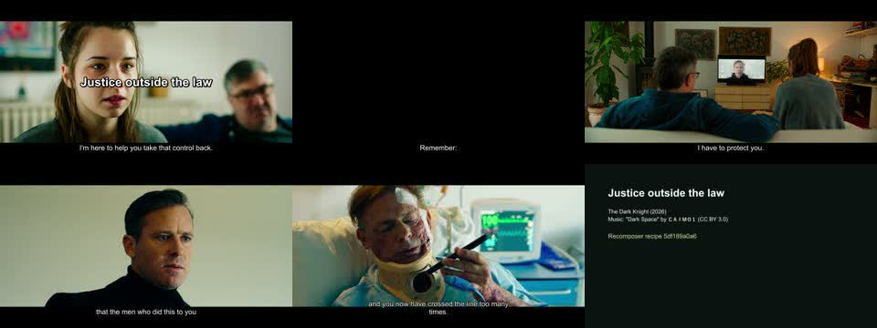
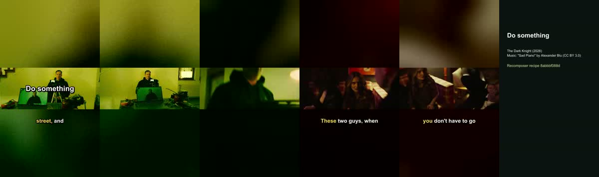
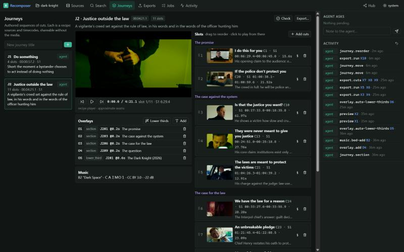
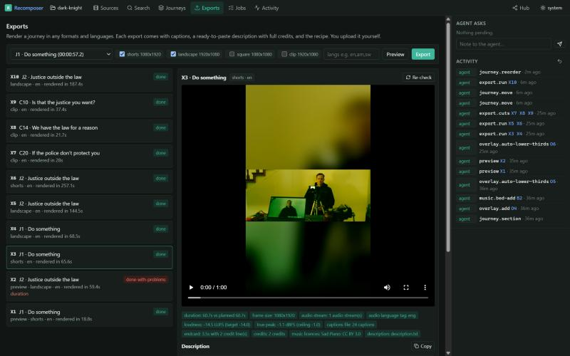

# M1: The Dark Knight acceptance run

**Date:** 2026-10-15 · **Project:** `C:\Recomposer\projects\dark-knight` · **Operator:** Claude (agent) through the `recomp` CLI

The film in `D:\Recomp\Video` is a 2026 European vigilante thriller titled *The Dark Knight*
(89 min, 1920×800, AAC 5.1), not Nolan's film. Its `.srt` matched the file.

## What was done, step by step (plan §7.1)

| # | Step | Result |
|---|---|---|
| 1 | `project init dark-knight --kind movies` | Project folder with the agent kit (AGENTS.md, CLAUDE.md, 6 skills, .mcp.json) |
| 2 | `source add "D:\Recomp\Video\The.Dark.Knight*.mp4"` | S1, file referenced in place; `.srt` imported as S1.t1 (1,053 cues, 0 problems); title and year parsed from the release name |
| 3 | probe, audio, peaks, shots, thumbnails (background jobs) | audio 7 s, peaks 0.3 s, shots 79 s (1,300 boundaries), thumbnail sprites 108 s |
| 4 | `transcript sync-check S1.t1` | **in sync**: offset −0.09 s, 5,079 words matched, per-window −0.01 / −0.15 / −0.14 s |
| 5 | Full local ASR (`transcript asr S1`) | S1.t2, 799 segments; **1,789 s for 5,342 s of audio (RTF 0.33)** on CPU, faster-whisper turbo int8 |
| — | `transcript align S1.t1 --using S1.t2` | 86 % of subtitle words given spoken timings; lines whisper missed (under music) keep proportional timing |
| 6 | Read the transcript (`outline` + 5 windows) and wrote chapters and cuts | **22 chapters** with summaries and tags; **26 cuts** with titles, *why*, tags and emotions, snapped to words and shots |
| 7 | Journeys | **J1 "Do something"** (4 slots, 57 s); **J2 "Justice outside the law"** (11 slots, 4:21, four sections: The promise / The case against the system / The case for the law / The question) |
| 8 | Music and overlays | Openverse CC BY 3.0 beds: "Sad Piano" (Alexander Blu) under J1, "Dark Space" (CAIMO1) under J2; title cards, section cards, auto lower thirds |
| 9 | Exports | J1 and J2 in `shorts` and `landscape`; clips C20, C14, C10; previews first |
| 10 | Checks | All final exports pass (table below) |
| 11 | Reorder J2 (2 slots moved) and re-export | 11/11 slots from cache; see the gate note |
| 12 | Viewer walkthrough | Screenshots below |

### Exports

| Export | What | Render time | Length (planned) | Loudness | True peak | Captions |
|---|---|---|---|---|---|---|
| X3 | J1 shorts 1080×1920 | 66 s | 60.7 s (60.7) | −14.5 LUFS | −1.1 dBFS | 24 |
| X4 | J1 landscape 1920×1080 | 69 s | 60.7 s (60.7) | −14.5 | −1.1 | 24 |
| X5 | J2 landscape | 145 s (warm slots) / 265 s cold | 264.6 s (264.57) | −14.6 | −1.5 | 90 |
| X6 | J2 shorts | 257 s | 264.6 s (264.57) | −14.6 | −1.5 | 90 |
| X7–X9 | clips C20, C14, C10 | 22–37 s | exact | −14.2 to −14.7 | −1.1 to −1.9 | 6–21 |

Each export folder holds `video.mp4`, `captions.srt`, `description.txt` (title, intent, source
credits with the exact moments used, music credit with licence link, recipe hash, hashtags),
`credits.json`, `recipe.json`, `thumb.jpg`, `plan.json` and `overlay.ass`. Exports total 296 MB; caches 679 MB.

### Viewer

## Problems found and fixed during the run

1. **Whisper word times run early** (about 0.4 s on the fixture). Fix: ASR word starts are snapped to the real
   energy onset after a pause (`transcript/refine.py`); sync estimates then match ground truth within 0.04 s.
2. **A repeated phrase borrowed timings from the next line.** Whisper missed "I'm here to help you take that
   control back" (under music), and the aligner matched it to the following "I'm here to show you". Fix: a matched
   word must lie within ±0.6 s of its own subtitle line, and lines with under half their words matched keep
   proportional timing. C26 was re-snapped.
3. **Caption drift over long journeys.** AAC padding and frame rounding added about 34 ms per slot (0.37 s over
   11 slots). Fix: slot lengths are quantised to whole frames, each slot is padded and trimmed to its exact frame
   count, audio is assembled sample-exactly, and the final output is trimmed to the plan. All exports now match the
   plan to within 0.04 s.
4. **True-peak overshoot** (+2.4 dBFS in one preview). Fix: limiter at 4× oversampling with 1 dB headroom after
   two-pass loudness normalisation; a `true peak` check was added.
5. Vertical layout: lower thirds collided with karaoke captions; untimed lines showed as one block; karaoke chunks
   overlapped. All fixed (lower thirds move to the top on vertical; untimed lines are spread in time; chunks are clamped).

## Gates

| Gate | Result |
|---|---|
| Caption sync on fixtures < 80 ms | Met (onset-refined words within ~40 ms of true onsets) |
| Render determinism / source-time mapping | Met: pixel-colour tests map output time to source seconds exactly |
| Reorder re-export with warm cache < 25 % of cold | **Not met as stated**: 145–193 s vs 265 s cold (55–73 %). Every slot came from cache (11/11); the remaining time is the final pass, which must re-encode the whole timeline to burn captions and overlays. Proposed restatement: "a reorder re-renders no slots". A faster final-pass preset is the lever if this matters. |
| Agent → viewer latency < 1 s | Met: `ui show` moved the open viewer in about 0.5 s (SSE) |
| Viewer → agent selection | Met: a drag in the lanes is returned by `recomp ui selection` |

## A note on the content

This film presents a vigilante who kills judges and a migrant family as justified, and several scenes carry
anti-migrant and "takeover" rhetoric. I built the journeys around its moral question instead. J2 sets the
vigilante's creed against the Interpol chief's case for the rule of law; J1 is about the bystander's choice to act
(the bus fare, the spiked drinks). I left out the statistics monologues and the hostage scenes. If you post these,
note that platforms may flag the excerpts. Every export carries full credits, but rights for this film are not
recorded: `recomp source rights S1 --owner …` fills them in.
