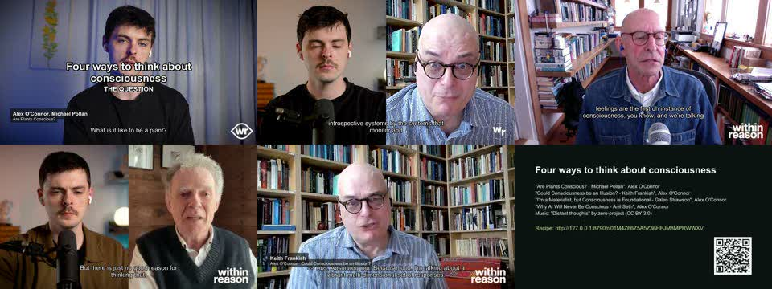
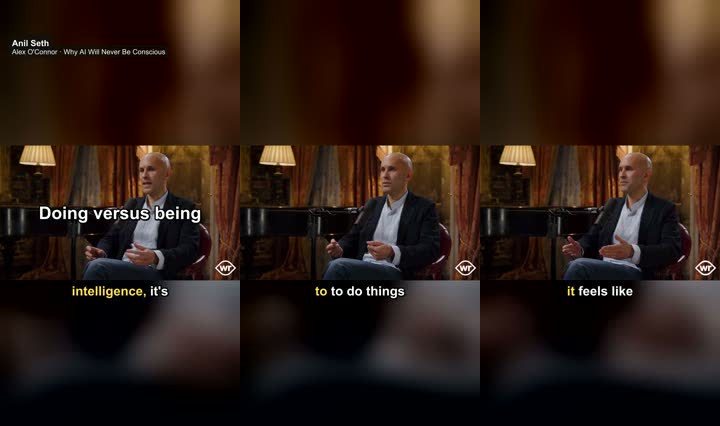
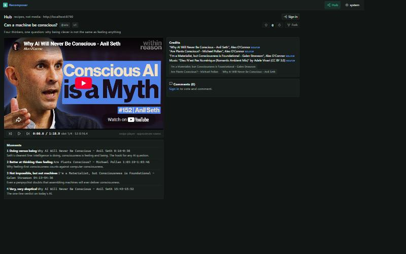

# M2: Alex O'Connor (links)

**Date:** 2026-10-15 · **Project:** `C:\Recomposer\projects\alex-oconnor` · **Theme (chosen by the agent, Q6):** consciousness

## What happened, step by step (plan §7.2)

| # | Step | Result |
|---|---|---|
| 1 | `project init alex-oconnor --kind channel` | project with the agent kit |
| 2 | `source add https://www.youtube.com/@CosmicSkeptic/videos --limit 30` | a 30-entry pick list (45 h of video), nothing added |
| — | `source add --pick 1,12,20,24,3` | **blocked**: YouTube answered "Sign in to confirm you're not a bot" for per-video requests. The five sources were added from the list's metadata (`metadata-partial`) and the run paused; listings kept working |
| — | *(evening)* block lifted; `source refresh S1…S5` | full metadata, **creator chapters** (12–15 per episode), caption languages |
| 3 | captions | word-timed auto captions (`en-orig`, with `>>` speaker turns) for all five: 571–1,332 lines each |
| 3b | audio + local ASR on S4 (the fallback path) | audio-only fetch, then faster-whisper: **58 min of audio in 27 min**; S4.t2 made primary |
| 4 | speakers | S5 diarised (2 voices, 4.4 min of CPU); named "Alex O'Connor" and "Priest (audience)"; S4 diarisation for cross-episode recognition (see below) |
| 5 | search → reading → cuts | `chapter seed`, `cut suggest`, `transcript read --chapter` on the relevant chapters; **12 cuts from 4 conversations** (Seth, Pollan, Frankish, Strawson), each with *why*, tags and speaker |
| 6 | journeys | **J1 "Can a machine be conscious?"** (4 slots, 3 guests, 1:19); **J2 "Four ways to think about consciousness"** (8 slots, 4 episodes, 5:34, five sections: The question / An illusion? / Feeling first / All the way down / And machines?); J3 "Doing versus being" (Seth only, 1:00) |
| 7 | video | whole episodes at ≤720p, once each: 217 MB, 305 MB, 444 MB, 1.9 GB (see note) |
| 8 | exports | J1 shorts + landscape, J2 landscape + shorts, J3 shorts; all checks pass |
| 9 | hub | J1–J3 published locally; the hub recipe page plays link recipes through the official YouTube player, slot by slot |

### Exports

| Export | What | Length (planned) | Loudness | True peak | Captions |
|---|---|---|---|---|---|
| X5 / X6 | J1 shorts / landscape | 82.4 s (82.4) | −14.5 LUFS | −1.7 dBFS | 12 |
| X7 | J2 landscape | 337.2 s (337.17) | −14.5 | −1.3 | 55 |
| X3 | J3 shorts | 63.2 s (63.17) | −14.2 | −1.6 | 8 |

Credits name each episode, the channel and the music; the J2 endcard carries the hub recipe link and QR code
because it was published before export.

## What this run changed in the code

1. **Bot-check fallback.** When per-video metadata is refused, `--pick` still adds sources from the list's metadata,
   and `source refresh` completes them later instead of failing the whole pick.
2. **Whole video at ≤720p instead of sections.** Section downloads through ffmpeg read the stream from the start
   to reach each cut, which stalled here for more than eight minutes on the first slot. Talks are small at 720p
   (1–4 MB per minute; 1080p is three to four times larger), so each source is fetched once and every later cut
   is local. Sections stay available (`config network.link_video sections`).
3. **Transient 403s** on googlevideo: video downloads retry with backoff (S1 succeeded on the second try).
4. **Lower thirds for episodes** name the guest and the episode title, without repeating the guest or the year.
5. **Layout:** name tags moved top-left; centre cards wait for the title instead of stacking.

## Speakers across episodes (P9 acceptance)

S5 was diarised and its voices named ("Alex O'Connor", "Priest (audience)"). S4 was then diarised with
`--speakers 2` and **Alex was recognised automatically**: SPEAKER_01 → P1 at cosine 0.902 (threshold 0.70),
520 lines labelled without a naming step. It took 1 h 51 min of CPU for 58 minutes of audio.

### Cheaper: naming speakers from `>>` marks (P15)

`speaker assign --by marks --names "A,B"` flips speakers at YouTube's `>>` turn marks. It needs no model and takes
0.3 s. Compared with diarisation, by speaking time:

| Episode | Lines | `>>` marks | Marks per minute | Agreement with diarisation |
|---|---|---|---|---|
| S5 (priest) | 115 | 11 | 2.5 | **86 %** |
| S4 (Strawson) | 571 | 20 | 0.35 | 50 % (chance) |

Dense marks give a usable labelling for free. Sparse marks fail, because one missed mark swaps every later line,
so the verb now reports mark density and warns below one mark per minute. For sparse episodes: name ranges
(`speaker assign S4 "Galen Strawson" --from … --to …`) or diarise.

## Re-export with clean captions (P15)

Auto captions overlapped (rolling lines stacked two at a time) and showed `>>` marks. Captions are now shown one at a time,
`>>` and [sound] tags are removed from what is displayed, and words follow edited text. J1 to J3 were exported again
(slots came from the cache; all checks pass; no `>>` and no two captions on screen at once in any of them):

| Export | What | Length (planned) | Loudness | True peak | Caption events |
|---|---|---|---|---|---|
| X17 / X14 | J1 shorts / landscape | 82.4 s (82.4) | −14.5 LUFS | −1.7 dBFS | 210 karaoke / 26 |
| X15 | J2 landscape | 337.2 s (337.17) | −14.5 | −1.3 | 104 |
| X16 | J3 shorts | 63.2 s (63.17) | −14.2 | −1.6 | 162 karaoke |

The first J1 shorts re-export (X13) still had one 10 ms overlap between two karaoke words (a minimum highlight
length); highlights now end exactly where the next word starts, and X17 replaces it.

## Notes

- The YouTube block lasted from ~06:30 to the evening; the JavaScript runtime (Node) is now passed to yt-dlp,
  which YouTube extraction requires. Browser cookies were never used.
- Captions from YouTube carry `>>` at speaker changes, which made attribution easy even before diarisation.
- S4's cuts were made on the caption transcript; after ASR became primary, exports use the ASR words. Both
  transcripts agree on these lines.
