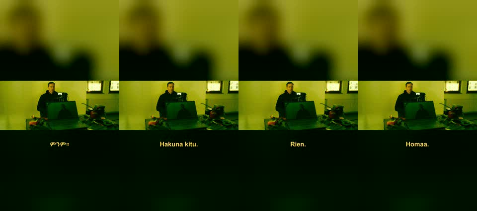
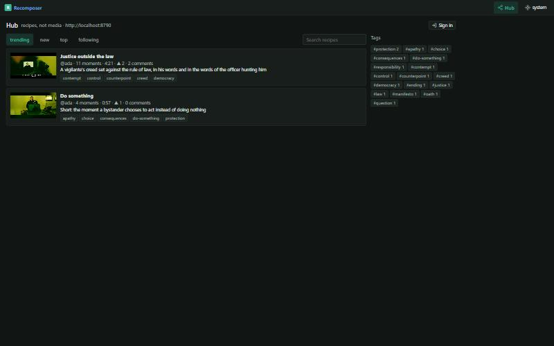
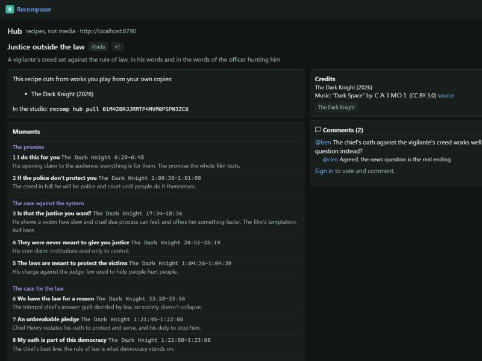

# M3 (languages) and M4 (hub) acceptance

**Date:** 2026-10-15 · **Project:** `dark-knight` · **Journey:** J1 "Do something" (4 slots, 57 s + endcard)

## M3: the short dubbed into three more languages, plus Afaan Oromo

| Step | What happened |
|---|---|
| Template | `lang translate J1 --to am --template`: 26 units (title, 24 spoken lines, the lower third), each line with a character budget from its timing |
| Translation | I wrote Amharic, Swahili and French myself (`--input`); Oromo was drafted with `--engine google` and cleaned (stray punctuation, "Homaa.") |
| Voices | edge-tts neural voices: `am-ET-MekdesNeural`, `sw-KE-ZuriNeural`, `fr-FR-DeniseNeural`; Oromo: `facebook/mms-tts-orm` (MMS-TTS, downloaded once into the worker cache) |
| Fit loop | Export → the `dub fit` check lists lines that don't fit → I shortened those → re-export (voiced lines are cached). Two rounds. |

### Final dubbed exports (shorts 1080×1920, voice-over over the ducked original, translated captions, overlays and endcard)

| Export | Language | Dub fit | Round-trip intelligibility | Loudness | True peak | Length |
|---|---|---|---|---|---|---|
| X26 | Amharic | 21 lines, 8 sped up, **2 overflowing**, 2 kept in the original voice | **CER 0.14** (Ethio-ASR) | −14.0 LUFS | −1.9 dBFS | 60.7 s = plan |
| X27 | Swahili | 21 lines, 8 sped up, **2 overflowing**, 2 kept | **WER 0.29** (whisper) | −14.0 | −1.9 | exact |
| X28 | French | 22 lines, 10 sped up, **3 overflowing**, 1 kept | **WER 0.09** (whisper) | −14.1 | −1.9 | exact |
| X29 | Afaan Oromo (stretch) | 22 lines, 15 sped up, **14 overflowing**, 1 kept | no recogniser for Oromo: listen | −14.1 | −1.7 | exact |

Every export also carries the right audio language tag (`amh`, `swa`, `fra`, `orm`), a translated `captions.srt`,
the translated title card and overlays, Ethiopic captions rendered in Ebrima, and `dub_roundtrip.txt` (what was
voiced against what the recogniser heard).

How fitting improved, by round (overflowing lines, am / sw / fr):

| Round | am | sw | fr | What changed |
|---|---|---|---|---|
| 1 | 11 | 15 | — | strict per-line windows |
| 2 | 16 | — | — | (bug: tail of a previous sentence voiced at the start of a cut) |
| 3 | 8 | 13 | 10 | voice-over placement with a 1 s delay budget; lines only voiced if mostly inside the cut; edge `rate` before time-stretch |
| 4 | 4 | 5 | 5 | the agent shortened the listed lines |
| 5 | **2** | **2** | **3** | short interjections that can't fit keep the original voice (as lang_bridge does) |

What remains is the rapid four-line exchange at the bar (31–40 s): two people talking over each other. A human
dubber would compress it further; I left it for your ears. Oromo overflows because the Google draft runs long and
MMS has no speaking-rate control. It needs an Oromo speaker to shorten the lines (backlog).

## M4: the hub

| Check | Result |
|---|---|
| Local hub | `python -m hub` on 127.0.0.1:8790; three test accounts seeded (`python -m hub.seed`; passwords stay in the hub data folder) |
| Publish | ada published J1 and J2 (`recomp hub publish`); re-publishing adds versions; the journey records its hub URL |
| Social | ben and cleo voted, commented and replied (threaded), and ben followed ada; the trending and following feeds order correctly |
| Fork and pull | a fork lands in the forker's account (private) and pulls into a project with identical slots (`tests/e2e/test_hub.py`) |
| Source pages | every recipe indexes its sources; a source page shows all recipes cut from it and a heatmap of the most-cut moments |
| Post links | `recomp hub link-post J1 <url>` records where a video was posted, on the journey and on the hub recipe |
| Guards | private recipes are invisible to others; recipes with local paths are refused; the agent can't create accounts on, or publish to, a non-local hub without `--confirm` |
| UI | Explore (trending/new/top/following, tags, search), recipe page (moments with sections, credits, comments, vote, fork, pull into the studio), profiles with follow, source pages, sign-in |

Recipes made only of links play on the hub through YouTube embeds (the recipe player). Recipes cutting films
show which works you need, and *Pull into studio* matches your own copies.
