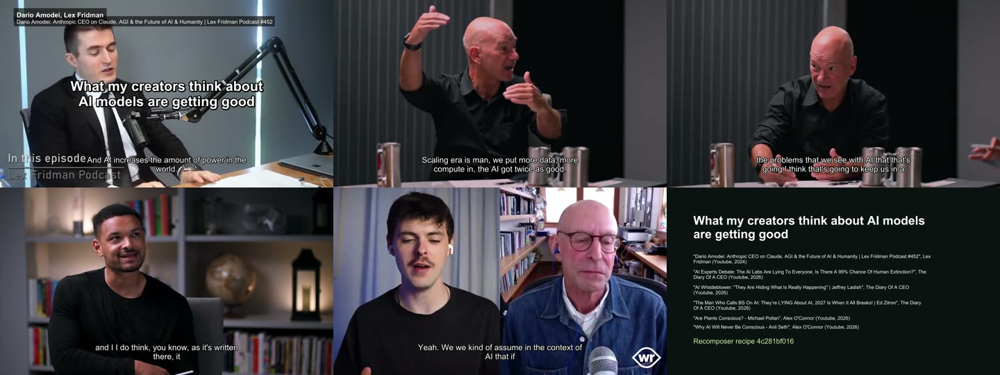
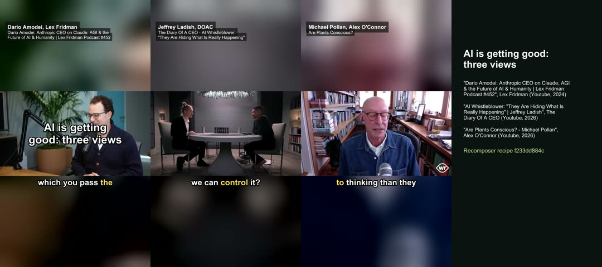

# M5: follows and topics (P17)

**Dates:** 2026-10-19 (follows, inbox, topic scan; session paused at the usage limit) → 2026-10-20 (matching,
journeys, exports, rights) · **Project:** `C:\Recomposer\projects\ai-and-ideas` (themes AI, superintelligence, AGI,
consciousness) · **Studio:** `%USERPROFILE%\.recomp\studio.db`

## Result against the plan (§6, P17 "Done when")

| # | Criterion | Result |
|---|---|---|
| 1 | `find creators` returns channels, podcasts and appearances; four creators followed; a second check finds nothing | **Done.** Lex Fridman (F1) and The Diary of a CEO (F2) followed from the Find tab, Alex O'Connor (F3, channel + Within Reason) by CLI, **Dwarkesh Patel (F4)** found with `find creators "Dwarkesh Patel"` (channels, the podcast, appearances; his feed answered 502, so the channel is followed). First checks filled the inbox (F4: 3 new, 12 held back as seen). The second check — CLI and the page's **Check now** — found 0 new on all four. |
| 2 | Taking a new episode → cheapest transcript, creator chapters, cut candidates; the agent makes a journey of two | **Done.** I1 (Lex #502, psychiatry) → S1 with the lexfridman.com transcript (speakers named), 14 creator chapters and a candidate. The agent read the candidates for the episode's own subject and cut **C8 "Lobotomy won a Nobel Prize"** and **C9 "The Lobotomobile"** → **J2 "The ice pick lobotomy"** (1:56, shorts + landscape). |
| 3 | Topic "AI models are getting good": brief ≥ 3 creators incl. an episode older than a year; a journey of ≥ 6 cuts from ≥ 3 creators; exported as shorts and landscape with credits | **Done.** T1's brief: 34 passages, 12 episodes, 3 creators, 2024-11-11 (Dario Amodei on Lex) → 2026-10-08. **J1** (7 cuts: Lex ×2, DOAC ×3, Alex ×2; 6:44) exported landscape (X4); its Shorts version **J3** (3 cuts, one per creator, 2:42) exported shorts (X3). All checks pass. |
| 4 | `post plan` refuses a private source; `hub publish` with private sources stops without `--confirm` and stores the answer and time | **Partly live.** `post plan X1` (J3 shorts) → **E_RIGHTS** naming S2, S4, S6 (all `private`). The hub half was not run live: this session's permission check refused `hub publish --visibility public` (it reads as making a public surface, even on the local hub), and a "yes" may only come from you. The stop and the stored answer are covered by `tests/e2e/test_hub.py::test_public_needs_the_users_permission_for_private_sources`. |
| 5 | The Follows and Topics pages do all of the above without typing | **Done** (checked in the browser pane, P17d and today): Follow from Find, Take, Check now, Scan, ticking passages and **Draft journey** (made J4 from p4 + p5 and opened it at the Look step with lower thirds). |

### Exports

| Export | What | Length (planned) | Loudness | True peak | Captions | Credits |
|---|---|---|---|---|---|---|
| X3 | J3 shorts 1080×1920 | 165.7 s (165.7) | −14.1 LUFS | −1.6 dBFS | 14 | 3, endcard + description |
| X4 | J1 landscape 1920×1080 | 407.8 s (407.8) | −14.2 LUFS | −1.7 dBFS | 56 | 6, endcard + description |

X1/X2 were the first renders: 24 min (J3) and 30 min (J1), almost all of it fetching six whole videos at ≤720p
(Lex #452 alone is 5 h 15 min). Their endcards had overlapping credits (fix 3 below); X3/X4 re-rendered with the
fix from the slot cache in 2 min 41 s and 5 min 43 s. The description carries every source with its moments and link.

## What this run changed in the code

1. **Podcast-only episodes are cut from their YouTube upload** (`recomp/research/match.py`). DOAC's feed titles
   differ from its video titles ("AI Insider: We Are Losing Control Faster Than You Think" is "AI Whistleblower:
   'They Are Hiding What Is Really Happening'" on YouTube) and the feed audio carries intros and ads. The matcher
   searches YouTube, keeps the creator's own channel (never "… Clips") at a similar length, and confirms by
   **words**: podcast minutes 10–20 must line up with the video's captions (≥ 40 words). Jeffrey Ladish: 1,749
   words matched at +6.3 s. The captions become the video's transcript, and each passage is shifted by an offset
   measured **near it**: in Ed Zitron's episode the offset is −20.0 s up to 1:31:40 (podcast clock) and −37.5 s
   at 1:56:40: an inserted ad between the two. All seven J1 cuts start and end on their passages' words.
2. **Lower thirds name who is talking.** Cuts from transcripts without speaker names were credited to the creator
   ("DOAC", "Alex O'Connor") while their guests spoke. `journey from-topic` now credits the guest named in the
   title ("… | Jeffrey Ladish", "… - Michael Pollan", "#452 – Dario Amodei: …") with the creator, and a Lex
   transcript line without a speaker continues the previous speaker (C2 is Dario, not Lex). The source line drops a
   trailing " | Guest" as it did " - Guest" (and no longer cuts "| Lex Fridman" out of "| Lex Fridman Podcast #452").
3. **Endcard credits no longer overlap.** Long credit lines were wrapped by libass while the layout advanced one
   row per credit, so wrapped rows were drawn over the next credit (visible in both first renders). Credits are now
   wrapped to the width there is, each starts below the last row of the one before, and the type shrinks when they
   would not fit above the recipe line.
4. **Validate notes** for link sources: one per source, describing what export will do (download the whole video
   once, or only each slot's range with `network.link_video sections`), and none once the video is fetched.

## Notes

- YouTube answered per-video requests today (metadata, captions, six video downloads) without cookies.
- J4 (two cuts, C10–C11) is the page test of "Draft journey". The page records clicks as yours, so the precedence
  guard keeps the agent from deleting it: delete it in the studio, or tell me to (`journey delete J4 --as-user`).
- F2 is still labelled "DOAC"; with "Steven Bartlett" the lower thirds would read "Jeffrey Ladish, Steven Bartlett".
- Nothing was posted or published. Posting needs a `permitted` or `campaign` status with evidence on each source.
